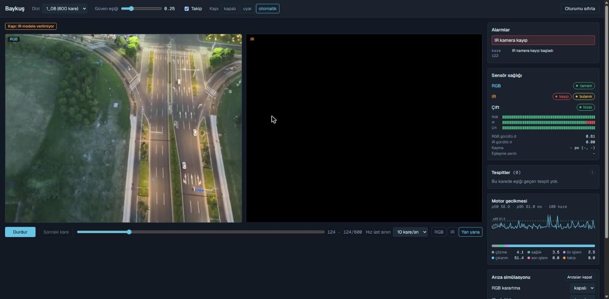

# Baykuş 🦉

**RGB-Thermal aerial vehicle detection on the edge** — drone görüntülerinde normal (RGB) ve termal (IR)
kamerayı birleştirerek gece-gündüz araç tespiti; bir kamera bozulsa da çalışan, laptop işlemcisinde
gerçek zamana yakın, her sayısı ölçümle kanıtlı bir sistem.

> **Durum: `v0.2.0` — Faz 3 (sistem).** C++ çıkarım motoru, takip, operatör ekranı ve internetsiz Docker
> kurulumu tamam; Faz 1 (model, ölçüm) ve Faz 2 (sensör sağlığı) üzerine. Tasarım: [docs/spec.md](docs/spec.md) ·
> sistem raporu: [docs/system.md](docs/system.md) · deney günlüğü: [docs/experiments.md](docs/experiments.md) ·
> kararlar: [docs/adr/](docs/adr/)

## Sevk edilen sistem

**E3c · ONNX FP32:** RGB + IR'yi 4 kanal olarak alan tek YOLO26s modeli, eğitimde rastgele bir kamerası
kapatılarak (modality dropout) eğitildi.

| | Değer | Kaynak |
|---|---|---|
| Test mAP50 (DroneVehicle, IR etiketleri) | **81,4** [80,4; 82,5] | `results/edge/*_test_onnx_fp32_ir.json` |
| Laptop CPU gecikmesi (Ryzen 7 8845HS) | p50 **46 ms** · p95 **60 ms** · **21 FPS** | `results/bench/e3c_modality_dropout_onnx_fp32_laptop-cpu.json` |
| Bir kamera tamamen kapanınca (val) | RGB yok: 82,9 · IR yok: 72,0 | [docs/robustness.md](docs/robustness.md) |
| Model dosyası | 38 MB | — |

Seçim, ölçümden **önce** yazılmış bir kuralla yapıldı ([ADR 0007](docs/adr/0007-latency-target.md)):
laptop CPU'da p95 ≤ 100 ms ve en fazla 1 puan doğruluk kaybı. İki modelli geç füzyon (E4) daha sağlam
ama işlemcide 2 kat yavaş (p95 132 ms), bu yüzden elendi.

## Sonuçlar

### Ana tablo (test seti, bir kez ölçüldü)

mAP50, IR etiketleri, [görüntü düzeyinde bootstrap %95 güven aralığı]. Bütün seçimler val'de yapıldı;
test seti en sonda bir kez kullanıldı.

| Model | mAP50 | Gündüz | Gece | Karanlık gece |
|---|---|---|---|---|
| E1 — sadece RGB | 73,3 [72,1; 74,5] | 80,0 | 74,6 | 66,9 |
| E2 — sadece IR | 81,0 [79,9; 82,1] | 79,8 | 78,5 | 82,5 |
| E3 — erken füzyon (4 kanal) | 82,3 [81,2; 83,4] | 83,2 | 79,0 | 82,9 |
| **E3c — E3 + modality dropout** | **82,5** [81,4; 83,5] | 82,8 | 79,6 | 83,1 |
| E4 — geç füzyon (E1 + E2, WBF) | 82,0 [81,0; 83,0] | 82,8 | 80,1 | 82,0 |
| E4b — E4 + aydınlatmaya göre ağırlık | 82,2 [81,2; 83,2] | 83,3 | 80,1 | 82,0 |


- Karanlıkta normal kamera çöküyor (E1 66,9); füzyon modelleri 82-83'te kalıyor.
- Füzyon modelleri temiz veride birbirinden ayırt edilemiyor; fark **bozulmalarda** ortaya çıkıyor.
- Tam tablo, etiket seti karşılaştırması: [docs/results-test.md](docs/results-test.md) · val:
  [docs/results.md](docs/results.md)

### Sağlamlık: kamera bozulunca ne oluyor? (val)

| Koşul | E3 | **E3c** | E4 |
|---|---|---|---|
| Temiz | 85,7 | 85,1 | 84,8 |
| RGB kamera kapalı | 71,8 | **82,9** | 83,9 |
| IR kamera kapalı | 12,8 | **72,0** | 76,1 |
| RGB ×0,1 karartma | 73,8 | **83,2** | 83,5 |
| IR gürültüsü σ 20 | 39,9 | **53,5** | 51,3 |
| Bulanıklık (çekirdek 11) | 64,1 | 65,2 | **80,9** |
| IR 20 piksel kayık | 25,8 | 26,6 | **48,5** |


- Normal erken füzyon (E3) IR kamera kapanınca 12,8'e çöküyor; modality dropout'lu E3c 72,0'da kalıyor.
- Geç füzyon (E4) bulanıklık ve iki kamera arasındaki kaymaya karşı belirgin olarak daha dayanıklı; E3c'nin
  zayıf noktası bu. Ayrıntı ve güven aralıkları: [docs/robustness.md](docs/robustness.md)

### Edge: format × hassasiyet × donanım (val)

Laptop CPU: AMD Ryzen 7 8845HS, prize takılı, ONNX Runtime 1.30 CPU; batch 1, 640×640, 50 ısınma + 500 ölçüm; süre =
ön işleme + çıkarım + son işleme (geç füzyonda + WBF). Δ = aynı sistemin ONNX FP32'sine göre puan.

| Sistem | Hassasiyet | Boyut (MB) | mAP50 | Δ | p50 (ms) | p95 (ms) | FPS |
|---|---|---|---|---|---|---|---|
| **E3c** | **FP32** | 38,2 | 84,1 | 0 | **46,4** | **59,9** | 21,0 |
| E3c | FP16 | 19,2 | 84,1 | −0,0 | 49,3 | 62,5 | 19,7 |
| E3c | INT8 | 10,3 | 80,8 | −3,3 | 98,7 | 117,8 | 9,9 |
| E3c | INT8 (başlık FP32) | 11,6 | 83,4 | −0,7 | 90,1 | 108,1 | 10,9 |
| E4 | FP32 | 76,3 | 83,2 | 0 | 118,1 | 131,6 | 8,5 |
| E4 | INT8 (başlık FP32) | 23,1 | 83,0 | −0,2 | 203,9 | 224,4 | 4,9 |

GPU'da (Colab Tesla T4, TensorRT 11.4; ön işleme 2 çekirdekli CPU'da):

| Sistem | Hassasiyet | Motor (MB) | mAP50 | Δ | p50 (ms) | p95 (ms) | FPS |
|---|---|---|---|---|---|---|---|
| E3c | FP32 | 121,5 | 84,1 | −0,0 | 13,1 | 14,1 | 75,8 |
| E3c | FP16 | 92,9 | 84,1 | −0,0 | 9,9 | 11,4 | 99,3 |
| E3c | INT8 | 34,3 | 82,6 | −1,5 | 9,9 | 11,7 | 99,5 |
| E4 | FP16 | 189,0 | 83,2 | +0,0 | 29,0 | 40,9 | 32,3 |
| E4 | INT8 | 94,3 | 83,2 | +0,0 | 25,9 | 36,6 | 36,9 |

- **GPU'da iki sistem de gerçek zamanlı:** E3c ≈ 100 FPS, iki modelli E4 ≈ 37 FPS. Ekran kartı olan bir
  cihazda daha sağlam E4 seçilebilir; sevk kararı ekran kartsız laptop için verildi.
- **INT8 bu işlemcide hızlandırmadı, yavaşlattı** (VNNI desteğine rağmen): yalnız konvolüsyonlar
  nicemlendiği için katmanlar arasında sürekli INT8 ↔ FP32 dönüşümü var (tahmin, ölçülmedi). Tespit başlığı
  da INT8'e çevrilince doğruluk 3-8 puan düşüyor; başlık FP32 kalınca kayıp 1 puanın altında.
- TensorRT INT8 (ModelOpt) doğruluğu ORT INT8'den çok daha iyi korudu (E3c −1,5 puan); GPU'da INT8, FP16'dan
  belirgin hızlı değil, ön işleme artık darboğaz.
- Tam tablo ve sevk kuralının izi: [docs/results.md](docs/results.md) "Edge (E9)".

### Veri setleri arası test: M3OT (test, sınıfsız araç AP50)

| E1 RGB | E2 IR | E3 | E3c | E4 |
|---|---|---|---|---|
| 85,2 | 98,1 | 97,1 | 88,9 | 97,1 |

DroneVehicle'da eğitilen modeller hiç görmediği M3OT verisinde. M3OT'ta RGB ve IR etiketleri birbirine
hizalı değil (ortanca IoU 0,35); iki kamerayı birlikte kullanan modeller bundan etkileniyor. Ayrıntı:
[docs/data/m3ot.md](docs/data/m3ot.md)

## Faz 2: kamera bozulunca fark etmek (olumsuz sonuç)

Soru: sevk edilen E3c, bir kamera **bozuk veri** verirken çöküyor (IR 40 piksel kayınca val mAP50 9,0),
ama IR'yi hiç vermemek 72,0 alıyor. Yeniden eğitmeden, her karede iki kameranın sağlığını ölçüp bozuk
olanı modele vermeyen bir kapı bu farkı kapatır mı?

Yöntem: kare başına kural tabanlı ölçüler (gürültü, bulanıklık, parlaklık, kayıp kamera, RGB–IR kayması),
eşikler yalnız train'den; kapı zararlı kamerayı ön işlemeden önce sıfırlıyor. Kabul ölçütleri ölçümden
önce sabitlendi ([tasarım](docs/design/faz2.md) §6).

| mAP50 (IR etiketleri) | E3c | E3c + kapı | Fark [%95 GA] |
|---|---|---|---|
| Bozuk IR, val (gürültü σ 20, kayma 20 / 40 px; ortalama) | 29,7 | 70,4 | **+40,7** [+38,3; +43,1] |
| Bozuk IR, test (gürültü σ 20, kayma 20 px; ortalama) | 41,8 | 67,5 | **+25,7** [+24,6; +26,9] |
| Temiz val | 85,1 | 82,0 | **−3,1** [−4,4; −1,8] |
| Temiz test | 82,5 | 79,2 | **−3,3** [−3,9; −2,8] |

Kapı bozuk IR'de çok işe yarıyor, ama temiz karelerin %4'ünde yanlış tetikleniyor ve bu kareler pahalı.
Önceden yazılan kurala göre bu **başarısızlık**: kapı temiz veride sistemi kötüleştiriyor. Neden
bulundu: yanlış alarmların hepsi "IR hizasız" ve %80'i karanlık gece karesi; RGB karanlıkken iki
kameranın kenarları eşleşmiyor (faz korelasyonu yanıtı 0,05; normalde 0,56) ve kayma kestirimi anlamsız
bir değer buluyor. Düzeltme (zayıf eşleşmede hizasızlık kararı vermemek) Faz 3'e önceden kaydedildi;
val'e bakılarak bulunduğu için burada ölçülmedi.

Güven kalibrasyonu (sevk edilen ONNX FP32, test): ECE 0,080 → 0,007. Kalibrasyon skorları 80 değere
indirdiği için eşit skorlar sıralamayı bozup mAP50'yi 0,11 puan düşürüyor (önceden yazılan sınır 0,1);
eşitlikte ham skorla sıralanınca kayıp sıfır. Ayrıntı: [docs/health.md](docs/health.md).

## Faz 3: sistem — C++ motor, operatör ekranı, internetsiz kurulum



Sevk edilen E3c modeli C++ motorunda (ONNX Runtime + OpenCV) çalışıyor: kare başına kamera sağlığı,
kalibre skor ve ByteTrack takibi; Next.js ekranında oynatıcı, sağlık paneli, alarmlar ve arıza
simülasyonu. Her C++ adımı Python referansıyla aynı sonucu veriyor ve bu CI'da her commit'te sınanıyor.
Kabul ölçütleri ölçümden önce yazıldı; sekizi de geçti ([docs/system.md](docs/system.md), sayılar
kanıt dosyalarından üretiliyor).

| | Değer | Kaynak |
|---|---|---|
| C++ ↔ Python eşliği (tespit, letterbox, sağlık, takip) | 17 fikstür birebir; takip 2 × 600 karede fark 0 | `results/engine/parity_*.json` |
| Motor gecikmesi (Docker, çözme + sağlık + çıkarım + takip) | p50 **64,8 ms** · p95 **82,2 ms** (eşik 100) | `results/bench/*_laptop-docker.json` |
| M3OT test AP50 (motor, sınıfsız araç) | **86,0** (Faz 1 PyTorch 88,9) | `results/engine/m3ot_test_detect.json` |
| M3OT test takip: motor / oracle (M3OT kutuları) | HOTA **0,489** / 0,949 · IDF1 0,677 / 0,941 | `results/track/m3ot_test_*.json` |
| Kamera kaybı / IR gürültüsü alarmı (M3OT test) | karelerin %99,6'sında; temizde yanlış alarm %0 | `results/health/m3ot_test_health.json` |
| İnternetsiz çalışma | dış istek 0; Wi-Fi kapalı demo kayıtlı | `results/system/offline.json` |

- Takipçi doğru kutularla neredeyse kusursuz (oracle); motordaki kayıp tespitten geliyor.
- **IR hizasızlık alarmı M3OT'ta çalışmıyor:** iki kamera arasında doğal kayma var ve eşleşme yanıtı
  düşük; ürün kuralı temizde yanlış alarm vermiyor ama gerçek 20 px kaymayı da yakalamıyor.
- Model DroneVehicle'ın 5 sınıfını biliyor (motosiklet yok); yoğun trafikte (M3OT val, kare başına
  ≈ 11 araç) AP50 39,6'ya düşüyordu. Faz 4'te M3OT train ile ince ayarlanan E3c-M'de M3OT val AP50 88,5
  (`results/engine/m3ot_dev_detect.json`; test yalnız Faz 4 sonunda, bir kez).
- **Uzun görüntü kesintisinden sonra harita birkaç piksel kayabilir** (Faz 4): kamera kesinti sırasında
  yeni bir bölgeye ilerlediyse yeniden konumlama, M3OT val'de kesintisiz koşuya göre köşelerde ortanca
  2,6 px, p95 5,0 px fark veriyor (`results/motion/reloc_jumps_val.json`; Kabul 10 b, ADR 0011).
- H5'teki 60 ms Windows'ta yerel Python ölçümüydü; motor Docker'da ve çözme + sağlık dahil:
  **karşılaştırılamaz**.

**İnternetsiz kurulum.** İnternetli bilgisayarda bir kez `bash scripts/prepare.sh --bundle out/`
(imajlar, modeller, demo verisi); `out/` klasörünü taşıyıp internetsiz bilgisayarda:

```bash
docker load -i baykus-images.tar.gz
docker compose up
# tarayıcıda http://127.0.0.1:3000
```

İnternet varken tek komut: `bash scripts/prepare.sh && docker compose up`.

## Dürüst ölçüm notları

- **Tek seed:** her model bir kez eğitildi; güven aralıkları görüntü örneklemesinden, seed varyansı dahil
  değil.
- **Seçimler val'de:** WBF parametreleri, E3c / E4 seçimi ve sevk edilen varyant val'de seçildi; val'deki
  sayılar bu yüzden iyimser. Tarafsız sayılar test tablosunda.
- **İki etiket seti:** DroneVehicle'da RGB ve IR etiketleri ayrı; ana tablo IR etiketleriyle
  ([ADR 0003](docs/adr/0003-ir-primary-label-set.md)). RGB etiketleriyle sonuçlar `docs/results-test.md`.
- **ONNX ≠ PyTorch:** ONNX FP32, PyTorch değerlendirmesinden ≈ 1 puan düşük (test 81,4 / 82,5). Olası
  nedenler (ölçülmedi): uçtan uca çıktının görüntü başına 300 kutu sınırı ve kare 640×640 girdi.
- **INT8 doğruluğu Colab'ın işlemcisinde ölçüldü;** laptop çıktısıyla FP32 / FP16 birebir aynı, INT8 biraz
  farklı (sevk edilmedi).
- **M3OT kareleri ardışık video:** güven aralıkları iyimser.

## Mimari (Faz 1)

```
DroneVehicle (Kaggle) → baykus-data (kırpma, OBB→HBB, 4 kanallı TIFF, COCO)
  → baykus-train (Ultralytics YOLO26s, Colab) → baykus-eval (pycocotools, bootstrap GA)
  → baykus-robust (bozulma paketi) · baykus-fusion (WBF geç füzyon)
  → baykus-edge (ONNX / INT8 / TensorRT, doğruluk) → baykus-bench (p50/p95) → baykus-report
```

Python paketi: [python/src/baykus](python/src/baykus) · Colab notebook'ları: [notebooks/colab](notebooks/colab)

## Tekrarlama

```bash
cd python
uv sync --extra train
uv run pytest -q
uv run baykus-report                     # docs/results.md (val)
uv run baykus-report --split test --out ../docs/results-test.md --fig ../docs/figures/results/illumination-test.png
```

Eğitim ve GPU işleri Colab notebook'larıyla (00 → 08). Her sayı `results/**/*.json`'da; her JSON config,
git commit'i ve seed'iyle bağlı.

## Yol haritası

Faz 2 (bitti, olumsuz sonuç): kare başına sensör sağlığı, kanal kapısı, güven kalibrasyonu · Faz 3
(bitti, `v0.2.0`): C++ motoru, takip, operatör ekranı, internetsiz Docker kurulumu · Faz 4: hareketli
hedef · Faz 5: sunum. Ayrıntı: [docs/spec.md](docs/spec.md) §22.

## Lisans ve atıflar

- AGPL-3.0, çünkü Ultralytics YOLO AGPL-3.0. Üretim kullanımı Ultralytics Enterprise lisansı gerektirir.
- **DroneVehicle** (Sun ve ark., IEEE TCSVT 2022): lisansı belirtilmemiş, yeniden dağıtılmaz.
- **M3OT** (Scientific Data, 2025; CC BY 4.0): demo dizileri ve ölçümler; ekran görüntüleri bu veriden.
- ONNX Runtime (MIT), ensemble-boxes (MIT), pycocotools, OpenCV (Apache-2.0), trackers (Apache-2.0),
  Next.js (MIT).
