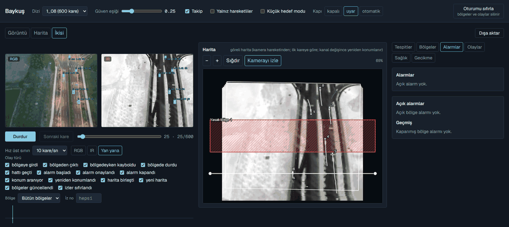
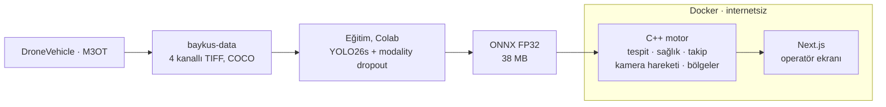

# Baykuş 🦉

**Drone görüntülerinde RGB + termal (IR) füzyonlu araç tespiti, takibi ve hareket analizi: laptop
işlemcisinde, internetsiz, her sayısı ölçümle kanıtlı.**



<sub>M3OT `1_08` dizisi; motor laptop CPU'da, Docker içinde. Solda RGB ve IR görüntü, ortada kamera
hareketinden kurulan göreli harita ve operatörün çizdiği yasak bölge; sağda yasak bölgeye giren araçların
alarmları.</sub>

## Ne yapar?

- **İki kamerayı tek modelde birleştirir:** RGB ve IR, 4 kanallı tek bir YOLO26s modeline girer. Eğitimde
  kameralardan biri rastgele kapatıldığı için (modality dropout) bir kamera bozulunca da çalışır.
- **C++ motoru** (ONNX Runtime + OpenCV): tespit, kamera sağlığı, ByteTrack takibi, kamera hareketinin
  çıkarılması, her araç için hareketli / duran kararı, bölgeler ve alarmlar. Her adım Python referansıyla aynı
  sonucu verir; bu CI'da her commit'te sınanır.
- **Operatör ekranı** (Next.js): oynatıcı, göreli harita, bölge çizimi (alan, yasak bölge, bekleme sınırı,
  sayım hattı), alarmlar, olay günlüğü (JSON / CSV) ve arıza simülasyonu.
- **İnternetsiz kurulum:** Docker imajları bir kez hazırlanır, internet olmayan bilgisayarda tek komutla açılır.

## Öne çıkan sonuçlar

| | Değer | Ayrıntı |
|---|---|---|
| Test mAP50 (DroneVehicle, sevk edilen ONNX model) | **81,4** [80,4; 82,5] | [details](docs/details.md#sevk-edilen-sistem) |
| Laptop CPU'da model gecikmesi (Ryzen 7 8845HS) | p95 **60 ms** · **21 FPS** | [details](docs/details.md#edge-format--hassasiyet--donanım-val) |
| IR kamera kapanınca (val mAP50) | normal füzyon 12,8 → modality dropout ile **72,0** | [robustness](docs/robustness.md) |
| M3OT test: araç bulma AP50 / takip HOTA (motor) | **98,8** / **0,771** | [motion](docs/motion.md) |
| Bütün motor hattı (çözme, sağlık, tespit, takip, hareket, 4 bölge) | p95 **97,9 ms** (eşik 100) | [motion](docs/motion.md) |
| C++ ↔ Python eşliği | 17 fikstür birebir; takip 2 × 600 karede fark 0 | [system](docs/system.md) |

## Nasıl çalışır?



- **Kamera hareketi:** IR görüntüsünde anahtar kareye Lucas-Kanade optik akışı ve RANSAC'lı benzerlik
  dönüşümü; görüntü kesilince ORB ile eski haritaya yeniden bağlanma.
- **Hareketli / duran:** harita üzerinde 15 karelik yer değiştirme, kutu boyuna bölünür; ≤ 0,03 duran,
  ≥ 0,10 hareketli, arası önceki karar.
- **Model seçimi:** ölçümden önce yazılmış kural ([ADR 0007](docs/adr/0007-latency-target.md)): laptop CPU'da
  p95 ≤ 100 ms ve en fazla 1 puan doğruluk kaybı. İki modelli geç füzyon daha sağlam ama 2 kat yavaş olduğu
  için elendi.

## Çalıştırma

```bash
bash scripts/prepare.sh        # imajlar, modeller, demo verisi (internet gerekir, bir kez)
docker compose up              # tarayıcıda http://127.0.0.1:3000
```

İnternetsiz bilgisayar için `bash scripts/prepare.sh --bundle out/`, ardından `out/` klasöründe
`docker load -i baykus-images.tar.gz && docker compose up`.

Testler: `cd python && uv run pytest -q` · `cd ui && npm test` · `bash scripts/engine_test.sh`

## Ölçüm ilkeleri

- **Test seti bir kez:** bütün seçimler val'de yapıldı; test en sonda ölçüldü. Kabul ölçütleri ölçümden önce
  yazıldı ve kararlar [ADR](docs/adr/)'lerde.
- **Olumsuz sonuçlar da yazıldı:** Faz 2'deki sensör sağlığı kapısı bozuk IR'de +25,7 puan kazandırdı, ama
  temiz veride 3,3 puan kaybettirdiği için önceden yazılan kurala göre **başarısız** sayıldı
  ([health](docs/health.md)).
- **Hareketli / duran ayrımı için "çalışıyor" denmiyor:** test dizilerinde duran araç yok, bu yüzden iddia
  kuralı tutmadı. Hareketli araçların %91,8'i doğru bulunuyor; duran araç içeren val'de dengeli doğruluk 0,823
  ([ADR 0009](docs/adr/0009-motion-eval.md)).
- Her model tek seed'le eğitildi; güven aralıkları görüntü örneklemesinden. Bütün notlar:
  [details](docs/details.md#dürüst-ölçüm-notları).

## Belgeler

| Belge | İçerik |
|---|---|
| [details.md](docs/details.md) | Bütün tablolar: test, sağlamlık, edge, M3OT, Faz 2-3, tekrarlama komutları |
| [faq.md](docs/faq.md) | Teknik sorular ve cevapları: neden bu tasarım, neler denendi |
| [motion.md](docs/motion.md) · [system.md](docs/system.md) · [health.md](docs/health.md) | Faz 4 / 3 / 2 raporları (kanıt dosyalarından üretilir) |
| [spec.md](docs/spec.md) · [adr/](docs/adr/) · [experiments.md](docs/experiments.md) | Tasarım, kararlar, deney günlüğü |

**Klasörler:** `python/` (veri, eğitim, değerlendirme, Python referansı) · `engine/` (C++ motor) · `ui/`
(Next.js) · `docker/` · `notebooks/colab/` (eğitim) · `results/` (her sayının JSON kanıtı) · `docs/`

## Durum

**`v1.0.0`.** Faz 1: model ve füzyon karşılaştırması · Faz 2: sensör sağlığı ve kalibrasyon (olumsuz
sonuç) · Faz 3: C++ motor, operatör ekranı, internetsiz kurulum (`v0.2.0`) · Faz 4: kamera hareketi,
hareketli / duran, bölgeler ve alarmlar (`v0.3.0`).

## Lisans ve atıflar

- AGPL-3.0, çünkü Ultralytics YOLO AGPL-3.0. Üretim kullanımı Ultralytics Enterprise lisansı gerektirir.
- **DroneVehicle** (Sun ve ark., IEEE TCSVT 2022): lisansı belirtilmemiş, yeniden dağıtılmaz.
- **M3OT** (Scientific Data, 2025; CC BY 4.0): demo dizileri ve ölçümler; ekran görüntüleri ve GIF bu veriden.
- ONNX Runtime (MIT), ensemble-boxes (MIT), pycocotools, OpenCV (Apache-2.0), trackers (Apache-2.0),
  Next.js (MIT).
