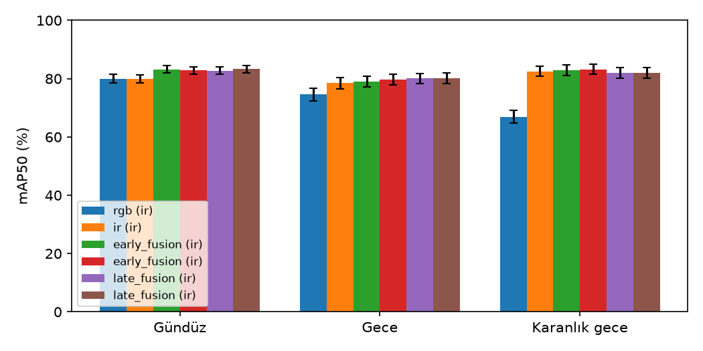

# Baykuş 🦉

**RGB-Thermal aerial vehicle detection on the edge** — drone görüntülerinde normal (RGB) ve termal (IR)
kamerayı birleştirerek gece-gündüz araç tespiti; bir kamera bozulsa da çalışan, laptop işlemcisinde
gerçek zamana yakın, her sayısı ölçümle kanıtlı bir sistem.

> **Durum: `v0.1.0` — Faz 1 (MVP).** Eğitim, değerlendirme, sağlamlık, veri setleri arası test ve edge
> ölçümü tamam. C++ motoru, takip ve operatör ekranı Faz 3'te. Tasarım: [docs/spec.md](docs/spec.md) ·
> deney günlüğü: [docs/experiments.md](docs/experiments.md) · kararlar: [docs/adr/](docs/adr/)

## Sevk edilen sistem

**E3c · ONNX FP32:** RGB + IR'yi 4 kanal olarak alan tek YOLO26s modeli, eğitimde rastgele bir kamerası
kapatılarak (modality dropout) eğitildi.

| | Değer | Kaynak |
|---|---|---|
| Test mAP50 (DroneVehicle, IR etiketleri) | **81,4** [80,4; 82,5] | `results/edge/*_test_onnx_fp32_ir.json` |
| Laptop CPU gecikmesi (Ryzen 7 8845HS) | p50 **46 ms** · p95 **60 ms** · **21 FPS** | `results/bench/e3c_modality_dropout_onnx_fp32_laptop-cpu.json` |
| Bir kamera tamamen kapanınca (val) | RGB yok: 82,9 · IR yok: 72,0 | [docs/robustness.md](docs/robustness.md) |
| Model dosyası | 38 MB | — |

Seçim, ölçümden **önce** yazılmış bir kuralla yapıldı ([ADR 0007](docs/adr/0007-latency-target.md)):
laptop CPU'da p95 ≤ 100 ms ve en fazla 1 puan doğruluk kaybı. İki modelli geç füzyon (E4) daha sağlam
ama işlemcide 2 kat yavaş (p95 132 ms), bu yüzden elendi.

## Sonuçlar

### Ana tablo (test seti, bir kez ölçüldü)

mAP50, IR etiketleri, [görüntü düzeyinde bootstrap %95 güven aralığı]. Bütün seçimler val'de yapıldı;
test seti en sonda bir kez kullanıldı.

| Model | mAP50 | Gündüz | Gece | Karanlık gece |
|---|---|---|---|---|
| E1 — sadece RGB | 73,3 [72,1; 74,5] | 80,0 | 74,6 | 66,9 |
| E2 — sadece IR | 81,0 [79,9; 82,1] | 79,8 | 78,5 | 82,5 |
| E3 — erken füzyon (4 kanal) | 82,3 [81,2; 83,4] | 83,2 | 79,0 | 82,9 |
| **E3c — E3 + modality dropout** | **82,5** [81,4; 83,5] | 82,8 | 79,6 | 83,1 |
| E4 — geç füzyon (E1 + E2, WBF) | 82,0 [81,0; 83,0] | 82,8 | 80,1 | 82,0 |
| E4b — E4 + aydınlatmaya göre ağırlık | 82,2 [81,2; 83,2] | 83,3 | 80,1 | 82,0 |



- Karanlıkta normal kamera çöküyor (E1 66,9); füzyon modelleri 82-83'te kalıyor.
- Füzyon modelleri temiz veride birbirinden ayırt edilemiyor; fark **bozulmalarda** ortaya çıkıyor.
- Tam tablo, etiket seti karşılaştırması: [docs/results-test.md](docs/results-test.md) · val:
  [docs/results.md](docs/results.md)

### Sağlamlık: kamera bozulunca ne oluyor? (val)

| Koşul | E3 | **E3c** | E4 |
|---|---|---|---|
| Temiz | 85,7 | 85,1 | 84,8 |
| RGB kamera kapalı | 71,8 | **82,9** | 83,9 |
| IR kamera kapalı | 12,8 | **72,0** | 76,1 |
| RGB ×0,1 karartma | 73,8 | **83,2** | 83,5 |
| IR gürültüsü σ 20 | 39,9 | **53,5** | 51,3 |
| Bulanıklık (çekirdek 11) | 64,1 | 65,2 | **80,9** |
| IR 20 piksel kayık | 25,8 | 26,6 | **48,5** |


- Normal erken füzyon (E3) IR kamera kapanınca 12,8'e çöküyor; modality dropout'lu E3c 72,0'da kalıyor.
- Geç füzyon (E4) bulanıklık ve iki kamera arasındaki kaymaya karşı belirgin olarak daha dayanıklı; E3c'nin
  zayıf noktası bu. Ayrıntı ve güven aralıkları: [docs/robustness.md](docs/robustness.md)

### Edge: format × hassasiyet (laptop CPU, val)

AMD Ryzen 7 8845HS, prize takılı, ONNX Runtime 1.30 CPU; batch 1, 640×640, 50 ısınma + 500 ölçüm; süre =
ön işleme + çıkarım + son işleme (geç füzyonda + WBF). Δ = aynı sistemin ONNX FP32'sine göre puan.

| Sistem | Hassasiyet | Boyut (MB) | mAP50 | Δ | p50 (ms) | p95 (ms) | FPS |
|---|---|---|---|---|---|---|---|
| **E3c** | **FP32** | 38,2 | 84,1 | 0 | **46,4** | **59,9** | 21,0 |
| E3c | FP16 | 19,2 | 84,1 | −0,0 | 49,3 | 62,5 | 19,7 |
| E3c | INT8 | 10,3 | 80,8 | −3,3 | 98,7 | 117,8 | 9,9 |
| E3c | INT8 (başlık FP32) | 11,6 | 83,4 | −0,7 | 90,1 | 108,1 | 10,9 |
| E4 | FP32 | 76,3 | 83,2 | 0 | 118,1 | 131,6 | 8,5 |
| E4 | INT8 (başlık FP32) | 23,1 | 83,0 | −0,2 | 203,9 | 224,4 | 4,9 |

- **INT8 bu işlemcide hızlandırmadı, yavaşlattı** (VNNI desteğine rağmen): yalnız konvolüsyonlar
  nicemlendiği için katmanlar arasında sürekli INT8 ↔ FP32 dönüşümü var (tahmin, ölçülmedi). Tespit başlığı
  da INT8'e çevrilince doğruluk 3-8 puan düşüyor; başlık FP32 kalınca kayıp 1 puanın altında.
- Tam tablo ve sevk kuralının izi: [docs/results.md](docs/results.md) "Edge (E9)".

### Veri setleri arası test: M3OT (test, sınıfsız araç AP50)

| E1 RGB | E2 IR | E3 | E3c | E4 |
|---|---|---|---|---|
| 85,2 | 98,1 | 97,1 | 88,9 | 97,1 |

DroneVehicle'da eğitilen modeller hiç görmediği M3OT verisinde. M3OT'ta RGB ve IR etiketleri birbirine
hizalı değil (ortanca IoU 0,35); iki kamerayı birlikte kullanan modeller bundan etkileniyor. Ayrıntı:
[docs/data/m3ot.md](docs/data/m3ot.md)

## Dürüst ölçüm notları

- **Tek seed:** her model bir kez eğitildi; güven aralıkları görüntü örneklemesinden, seed varyansı dahil
  değil.
- **Seçimler val'de:** WBF parametreleri, E3c / E4 seçimi ve sevk edilen varyant val'de seçildi; val'deki
  sayılar bu yüzden iyimser. Tarafsız sayılar test tablosunda.
- **İki etiket seti:** DroneVehicle'da RGB ve IR etiketleri ayrı; ana tablo IR etiketleriyle
  ([ADR 0003](docs/adr/0003-ir-primary-label-set.md)). RGB etiketleriyle sonuçlar `docs/results-test.md`.
- **ONNX ≠ PyTorch:** ONNX FP32, PyTorch değerlendirmesinden ≈ 1 puan düşük (test 81,4 / 82,5). Olası
  nedenler (ölçülmedi): uçtan uca çıktının görüntü başına 300 kutu sınırı ve kare 640×640 girdi.
- **INT8 doğruluğu Colab'ın işlemcisinde ölçüldü;** laptop çıktısıyla FP32 / FP16 birebir aynı, INT8 biraz
  farklı (sevk edilmedi).
- **M3OT kareleri ardışık video:** güven aralıkları iyimser.

## Mimari (Faz 1)

```
DroneVehicle (Kaggle) → baykus-data (kırpma, OBB→HBB, 4 kanallı TIFF, COCO)
  → baykus-train (Ultralytics YOLO26s, Colab) → baykus-eval (pycocotools, bootstrap GA)
  → baykus-robust (bozulma paketi) · baykus-fusion (WBF geç füzyon)
  → baykus-edge (ONNX / INT8 / TensorRT, doğruluk) → baykus-bench (p50/p95) → baykus-report
```

Python paketi: [python/src/baykus](python/src/baykus) · Colab notebook'ları: [notebooks/colab](notebooks/colab)

## Tekrarlama

```bash
cd python
uv sync --extra train
uv run pytest -q
uv run baykus-report                     # docs/results.md (val)
uv run baykus-report --split test --out ../docs/results-test.md --fig ../docs/figures/results/illumination-test.png
```

Eğitim ve GPU işleri Colab notebook'larıyla (00 → 07). Her sayı `results/**/*.json`'da; her JSON config,
git commit'i ve seed'iyle bağlı.

## Yol haritası

Faz 2: kare başına kamera güvenilirliği ve uyarlanabilir füzyon · Faz 3: C++ motoru, takip, operatör ekranı,
internetsiz Docker kurulumu · Faz 4: hareketli hedef · Faz 5: sunum. Ayrıntı: [docs/spec.md](docs/spec.md) §22.

## Lisans ve atıflar

- AGPL-3.0, çünkü Ultralytics YOLO AGPL-3.0. Üretim kullanımı Ultralytics Enterprise lisansı gerektirir.
- **DroneVehicle** (Sun ve ark., IEEE TCSVT 2022): lisansı belirtilmemiş, yeniden dağıtılmaz.
- **M3OT** (CC-BY-4.0).
- ONNX Runtime (MIT), ensemble-boxes (MIT), pycocotools, OpenCV (Apache-2.0).
