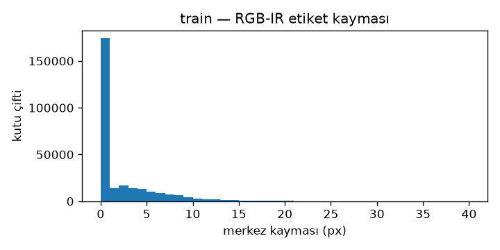
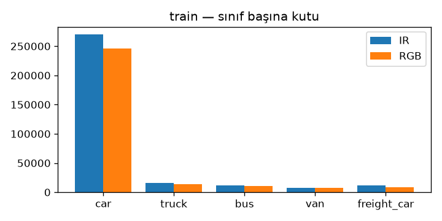
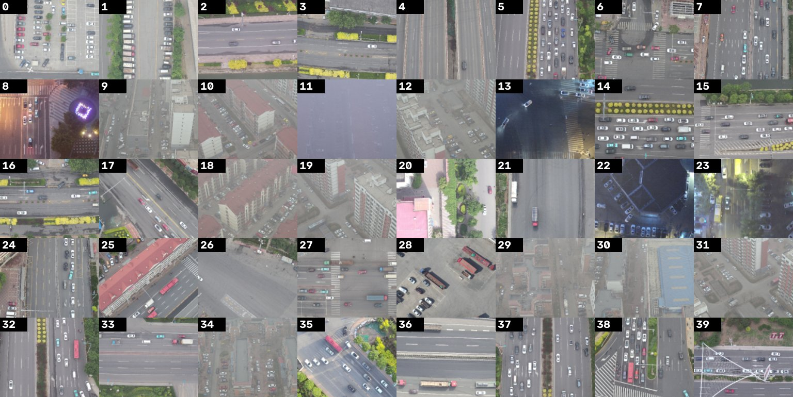
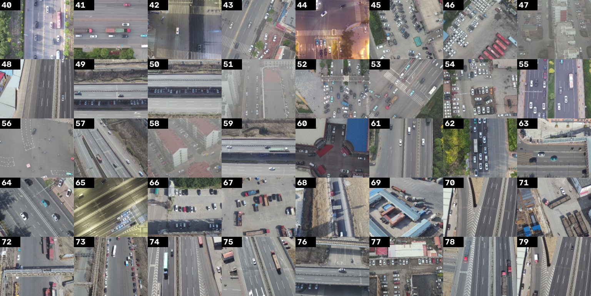
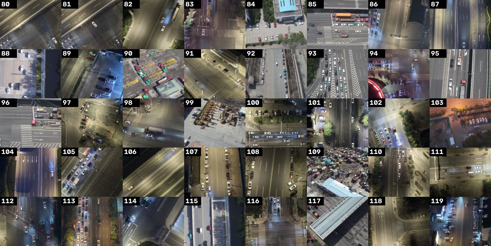
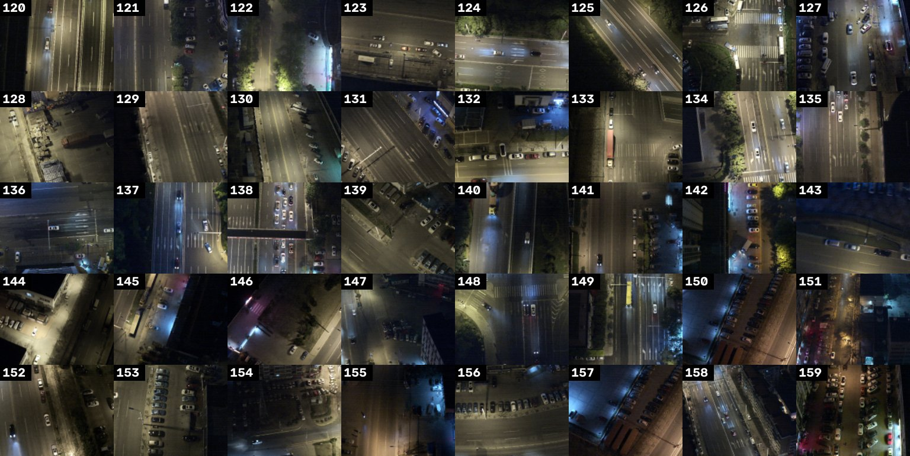

# E0 — DroneVehicle veri raporu

Bu rapor `baykus-data report` ile üretildi; elle düzenlenmez.

## Bütünlük

- Geçerli çiftler: {'train': 17954, 'val': 1469, 'test': 8980}
- Dışlananlar (nedene göre): {'unreadable_rgb': 14, 'unreadable_ir': 22}

## Etiket dönüşümü

```json
{
 "train": {
  "ir_kept": 315693,
  "ir_dropped": 1,
  "ir_unknown": 1,
  "ir_skipped": 22,
  "rgb_kept": 286086,
  "rgb_dropped": 1,
  "rgb_unknown": 1,
  "rgb_skipped": 21,
  "images": 17954
 },
 "val": {
  "ir_kept": 24490,
  "ir_dropped": 0,
  "ir_unknown": 0,
  "ir_skipped": 0,
  "rgb_kept": 22462,
  "rgb_dropped": 0,
  "rgb_unknown": 0,
  "rgb_skipped": 1,
  "images": 1469
 },
 "test": {
  "ir_kept": 159614,
  "ir_dropped": 2,
  "ir_unknown": 0,
  "ir_skipped": 16,
  "rgb_kept": 143314,
  "rgb_dropped": 1,
  "rgb_unknown": 0,
  "rgb_skipped": 15,
  "images": 8980
 }
}
```

## Görüntü ve kutu sayıları (IR vs RGB etiket seti)

| split | görüntü | kutu (IR) | kutu (RGB) | RGB-IR farkı | maks kutu/görüntü (IR) | boş görüntü |
|---|---|---|---|---|---|---|
| train | 17954 | 315693 | 286086 | -9.4% | 206 | 33 |
| val | 1469 | 24490 | 22462 | -8.3% | 135 | 2 |
| test | 8980 | 159614 | 143314 | -10.2% | 194 | 18 |

## Sınıf dağılımı (train)

| sınıf | IR | RGB |
|---|---|---|
| car | 269747 | 246102 |
| truck | 15808 | 13661 |
| bus | 11279 | 10366 |
| van | 7689 | 7263 |
| freight_car | 11170 | 8694 |

## Boyut dağılımı (COCO: küçük < 32², orta < 96²)

| split | küçük | orta | büyük |
|---|---|---|---|
| train | 43849 | 262704 | 9140 |
| val | 3996 | 19788 | 706 |
| test | 22897 | 131805 | 4912 |

## Aydınlatma (türetilmiş, ADR 0005)

| split | gündüz | gece | karanlık gece |
|---|---|---|---|
| train | 7403 | 5310 | 5241 |
| val | 607 | 447 | 415 |
| test | 3040 | 3114 | 2826 |

## RGB-IR etiket kayması (train)

Aynı nesnenin iki etiket setindeki merkez farkı (piksel). Görüntü başına aynı sınıftaki kutular artan uzaklığa göre eşlendi, en fazla 40 px. Eşsiz kutular ya diğer sette etiketlenmemiş ya da 40 px'ten fazla kaymış. Spec §8.2'deki '1-20 px' tahmininin ölçülmüş hali; E6 hizasızlık şiddetleri buna göre yorumlanır.

| eşleşen | eşsiz IR | eşsiz RGB | p50 px | p90 px | p99 px | > 10 px |
|---|---|---|---|---|---|---|
| 282292 | 33401 | 3794 | 0.0 | 7.2 | 16.6 | 4.8% |





## Aydınlatma etiketi doğrulaması

Gece/gündüz sınırı, gündüz-gece geçiş bölgesinden seçilen 160 elle etiketli örnekle belirlendi (ADR 0005; etiketler `docs/data/illum_check_labels.csv`). Numaralı sayfalar:








