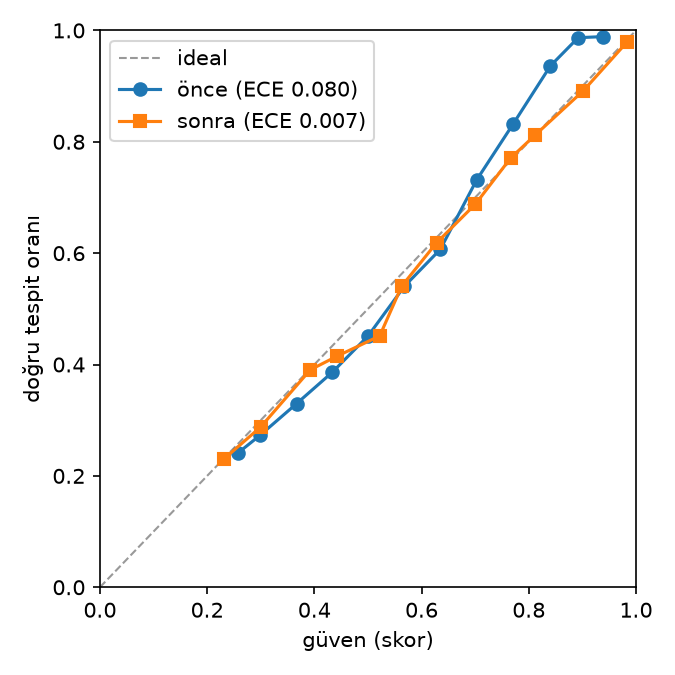

# Faz 2 — Sensör sağlığı kapısı ve güven kalibrasyonu

> Bu dosya `baykus-health report` ile `results/health/*.json`'dan üretildi; elle düzenlenmez. Hepsi IR etiketleri; GA = görüntü düzeyinde eşleştirilmiş bootstrap (1000, seed 42). mAP50 ve farklar puan.

## Yöntem

- Her karede RGB ve IR için kural tabanlı ölçüler: piksel std (kayıp), Immerkær gürültü kestirimi, Laplace varyansı (bulanık), parlaklık (karanlık, ADR 0005), kenar haritaları arasında faz korelasyonu kayması (hizasız). Eğitim yok.
- Kapı: modele zarar veren kamera ön işlemeden önce sıfırlanır (E3c değişmez). Öncelik kayıp > gürültülü > hizasız; iki kanal birden kapatılmaz; RGB'de yalnız kayıp kapıya girer.
- Kapı bir koşulun hiçbir pikselini değiştirmediyse kapılı tahminler Faz 1 tahminleriyle aynı (fark tam 0).

## Eşikler (train)

Kaynak: train bölümünden 500 görüntü (seed 42), sağlamlık paketinin bütün koşulları; Youden J. TPR / FPR: train'de, %.

| Durum | Kod | Özellik | Yön | Eşik | TPR | FPR |
|---|---|---|---|---|---|---|
| RGB kayıp | rgb_lost | rgb_std | ≤ | 0.086 | 100.0 | 0.0 |
| IR kayıp | ir_lost | ir_std | ≤ | 6.564 | 100.0 | 0.0 |
| IR gürültülü | ir_noisy | ir_noise | ≥ | 15.035 | 100.0 | 0.0 |
| IR hizasız | misaligned | misalign_px | ≥ | 16.158 | 97.9 | 6.7 |
| RGB bulanık (bilgi) | rgb_blurry | rgb_blur | ≤ | 32.574 | 96.8 | 11.6 |
| IR bulanık (bilgi) | ir_blurry | ir_blur | ≤ | 64.683 | 95.5 | 8.9 |

`karanlık` (RGB, bilgi): parlaklık < 48.66 (ADR 0005 t_dark). Train temiz karelerde kapı oranı: 5.0%.

## Arıza tespiti (val)

Görüntü oranı, %. Zararlı şiddetler: IR gürültüsü σ 20, hizasızlık 20 / 40 px, kamera kaybı. Karanlık ve bulanık yalnız bilgi.

| Koşul | Kapı | IR gürültülü | IR hizasız | IR kayıp | RGB kayıp | RGB karanlık | RGB bulanık | IR bulanık |
|---|---|---|---|---|---|---|---|---|
| clean | 4.1 | 0.0 | 4.1 | 0.0 | 0.0 | 28.3 | 1.2 | 0.0 |
| darken-0.5 | 4.6 | 0.0 | 4.6 | 0.0 | 0.0 | 54.0 | 7.3 | 0.0 |
| darken-0.25 | 4.6 | 0.0 | 4.6 | 0.0 | 0.0 | 100.0 | 40.9 | 0.0 |
| darken-0.1 | 5.2 | 0.0 | 5.2 | 0.0 | 0.0 | 100.0 | 97.2 | 0.0 |
| noise-5 | 4.3 | 0.0 | 4.3 | 0.0 | 0.0 | 28.3 | 1.2 | 0.0 |
| noise-10 | 4.7 | 0.0 | 4.7 | 0.0 | 0.0 | 28.3 | 1.2 | 0.0 |
| noise-20 | 100.0 | 100.0 | 5.0 | 0.0 | 0.0 | 28.3 | 1.2 | 0.0 |
| blur-3 | 4.2 | 0.0 | 4.2 | 0.0 | 0.0 | 28.3 | 20.9 | 14.2 |
| blur-7 | 4.2 | 0.0 | 4.2 | 0.0 | 0.0 | 28.3 | 93.2 | 90.2 |
| blur-11 | 4.4 | 0.0 | 4.4 | 0.0 | 0.0 | 28.3 | 99.9 | 99.9 |
| misalign-5 | 6.0 | 0.0 | 6.0 | 0.0 | 0.0 | 28.3 | 1.2 | 0.0 |
| misalign-10 | 11.0 | 0.0 | 11.0 | 0.0 | 0.0 | 28.3 | 1.2 | 0.0 |
| misalign-20 | 95.0 | 0.0 | 95.0 | 0.0 | 0.0 | 28.3 | 1.2 | 0.0 |
| misalign-40 | 99.7 | 0.0 | 99.7 | 0.0 | 0.0 | 28.3 | 1.2 | 0.0 |
| drop_rgb | 100.0 | 0.0 | 0.0 | 0.0 | 100.0 | 100.0 | 100.0 | 0.0 |
| drop_ir | 100.0 | 0.0 | 0.0 | 100.0 | 0.0 | 28.3 | 1.2 | 100.0 |

## Kapı (val)

| Koşul | Kapı % | E3c | E3c + kapı | Δ puan [%95 GA] |
|---|---|---|---|---|
| clean | 4.1 | 85.1 | 82.0 | -3.1 [-4.4, -1.8] |
| darken-0.5 | 4.6 | 84.1 | 81.0 | -3.1 [-4.4, -2.0] |
| darken-0.25 | 4.6 | 83.6 | 79.1 | -4.5 [-6.4, -2.9] |
| darken-0.1 | 5.2 | 83.2 | 76.7 | -6.5 [-8.9, -4.2] |
| noise-5 | 4.3 | 84.1 | 81.1 | -3.1 [-4.5, -1.8] |
| noise-10 | 4.7 | 77.0 | 74.1 | -2.9 [-4.1, -1.8] |
| noise-20 | 100.0 | 53.5 | 72.0 | +18.4 [+16.0, +21.0] |
| blur-3 | 4.2 | 83.1 | 80.8 | -2.3 [-3.4, -1.4] |
| blur-7 | 4.2 | 74.4 | 72.3 | -2.1 [-3.2, -1.3] |
| blur-11 | 4.4 | 65.2 | 63.3 | -1.9 [-3.0, -0.8] |
| misalign-5 | 6.0 | 83.4 | 80.1 | -3.2 [-4.6, -1.9] |
| misalign-10 | 11.0 | 69.6 | 66.1 | -3.4 [-4.8, -2.1] |
| misalign-20 | 95.0 | 26.6 | 68.2 | +41.6 [+38.1, +45.5] |
| misalign-40 | 99.7 | 9.0 | 71.1 | +62.1 [+58.8, +65.2] |
| drop_rgb | 100.0 | 82.9 | 82.9 | +0.0 [+0.0, +0.0] |
| drop_ir | 100.0 | 72.0 | 72.0 | +0.0 [+0.0, +0.0] |
| **Z ortalaması** (noise-20, misalign-20, misalign-40) | | | | **+40.7 [+38.3, +43.1]** |

## Kabul ölçütleri

Ölçümden önce sabit (`docs/design/faz2.md` §6).

| # | Ölçüt | Değer | Sonuç |
|---|---|---|---|
| Kabul 1 | temiz val'de fark ≥ −0,5 puan | -3.09 | ❌ |
| Kabul 2 | Z birleşik %95 GA tamamen 0'ın üstünde | [+38.3, +43.1] | ✅ |
| Kabul 3 | temiz val'de kapı alarmı ≤ %2 görüntü | 4.08% | ❌ |
| Kabul 4 | kalibrasyonla \|ΔmAP50\| ≤ 0,1 puan (test) | 0.112 | ❌ |

## Test kontrolü

Tek sefer, 3 koşul; seçim yapılmadı (tasarım §6.4). Bootstrap (1000, seed 42).

| Koşul | Kapı % | E3c | E3c + kapı | Δ puan [%95 GA] |
|---|---|---|---|---|
| clean | 5.0 | 82.5 | 79.2 | -3.3 [-3.9, -2.8] |
| noise-20 | 100.0 | 54.0 | 69.0 | +15.0 [+13.9, +16.1] |
| misalign-20 | 95.1 | 29.6 | 66.0 | +36.5 [+34.7, +38.2] |
| **Z ortalaması** (noise-20, misalign-20) | | | | **+25.7 [+24.6, +26.9]** |

## Kalibrasyon (test)

E3c · ONNX FP32 (sevk edilen); tablo val'de izotonik regresyonla, ECE testte ham skoru ≥ 0,25 olan 174487 tespitte, 15 eşit aralık.

ECE 0.080 → 0.007.

| | Önce | Sonra |
|---|---|---|
| ECE | 0.080 | 0.007 |
| mAP50 | 81.4 | 81.3 |

## Sınırlamalar

- Bozulmalar sentetik (sağlamlık paketi); gerçek kamera arızasında dedektör ayrıca doğrulanmadı (Faz 3'te M3OT dizilerinde niteliksel kontrol).
- Zarar düzeyleri Faz 1'in val ölçümlerinden, eşikler train'den; val değerlendirmesi hafif iyimser olabilir. Test kontrolü bunun için.
