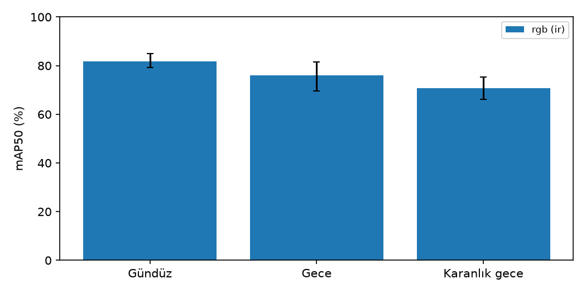

# Sonuçlar (val, ir etiketleri)

> Bu dosya `baykus-report` ile `results/runs/*.json`'dan üretildi; elle düzenlenmez.
> Köşeli parantez: görüntü düzeyinde bootstrap %95 güven aralığı (FR-V8).

| Çalıştırma | Mod | Split | Etiket | mAP50 [%95 GA] | mAP50-95 | Gündüz | Gece | Karanlık gece |
|---|---|---|---|---|---|---|---|---|
| 2026-10-11_e1-rgb_s_49da0cb | rgb | val | ir | 76.1 [73.6, 78.9] | 48.3 | 81.8 | 76.0 | 70.8 |

