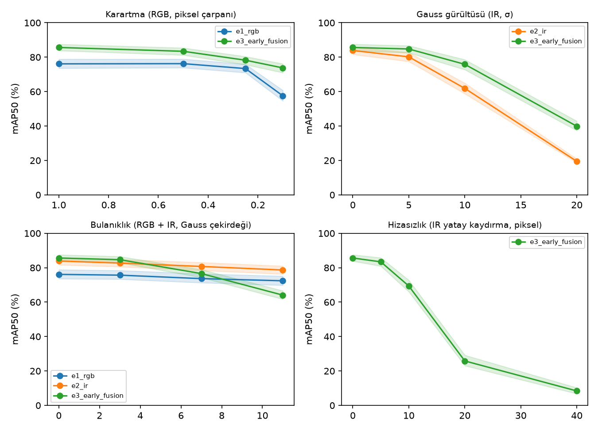

# Sağlamlık paketi (val, IR etiketleri)

> Bu dosya `baykus-robust report` ile `results/robust/*.json`'dan üretildi; elle düzenlenmez.
> Hücre: mAP50 [görüntü düzeyinde bootstrap %95 GA]. `—` ölçülmedi; `uygulanmaz` bozulma modelin görmediği modaliteye ait ya da tek modaliteli modelde hizasızlık.
> Karartma piksel değerini çarpanla ölçekler (gamma eğrisi değil). Hizasızlıkta IR kaydırılır, etiketler yerinde kalır.

## Karartma (RGB, piksel çarpanı)

| Şiddet | e1_rgb | e2_ir | e3_early_fusion |
|---|---|---|---|
| 1 (temiz) | 76.1 [73.6, 78.9] | 83.9 [81.7, 85.9] | 85.7 [83.8, 87.6] |
| 0.5 | 76.2 [73.9, 78.9] | uygulanmaz | 83.4 [81.2, 85.4] |
| 0.25 | 73.4 [71.0, 75.9] | uygulanmaz | 78.2 [75.7, 80.4] |
| 0.1 | 57.6 [54.6, 60.8] | uygulanmaz | 73.8 [71.0, 76.2] |

## Gauss gürültüsü (IR, σ)

| Şiddet | e1_rgb | e2_ir | e3_early_fusion |
|---|---|---|---|
| 0 (temiz) | 76.1 [73.6, 78.9] | 83.9 [81.7, 85.9] | 85.7 [83.8, 87.6] |
| 5 | uygulanmaz | 80.2 [77.5, 82.7] | 84.8 [82.6, 86.7] |
| 10 | uygulanmaz | 61.9 [58.8, 64.9] | 75.9 [72.8, 78.6] |
| 20 | uygulanmaz | 19.5 [18.6, 20.9] | 39.9 [37.3, 42.9] |

## Bulanıklık (RGB + IR, Gauss çekirdeği)

| Şiddet | e1_rgb | e2_ir | e3_early_fusion |
|---|---|---|---|
| 0 (temiz) | 76.1 [73.6, 78.9] | 83.9 [81.7, 85.9] | 85.7 [83.8, 87.6] |
| 3 | 75.7 [73.4, 78.4] | 82.7 [80.6, 84.8] | 84.7 [82.9, 86.5] |
| 7 | 73.7 [71.3, 76.5] | 80.7 [78.4, 83.1] | 76.6 [74.3, 78.9] |
| 11 | 72.4 [69.8, 75.1] | 78.7 [76.4, 81.0] | 64.1 [61.7, 66.6] |

## Hizasızlık (IR yatay kaydırma, piksel)

| Şiddet | e1_rgb | e2_ir | e3_early_fusion |
|---|---|---|---|
| 0 (temiz) | 76.1 [73.6, 78.9] | 83.9 [81.7, 85.9] | 85.7 [83.8, 87.6] |
| 5 | uygulanmaz | uygulanmaz | 83.4 [81.0, 85.8] |
| 10 | uygulanmaz | uygulanmaz | 69.4 [66.1, 72.8] |
| 20 | uygulanmaz | uygulanmaz | 25.8 [23.1, 29.2] |
| 40 | uygulanmaz | uygulanmaz | 8.4 [6.8, 10.3] |

## Kamera kaybı

| Koşul | e1_rgb | e2_ir | e3_early_fusion |
|---|---|---|---|
| Temiz | 76.1 [73.6, 78.9] | 83.9 [81.7, 85.9] | 85.7 [83.8, 87.6] |
| RGB kaybı | 0.0 [0.0, 0.0] | uygulanmaz | 71.8 [68.8, 74.3] |
| IR kaybı | uygulanmaz | 0.0 [0.0, 0.0] | 12.8 [11.6, 14.3] |

